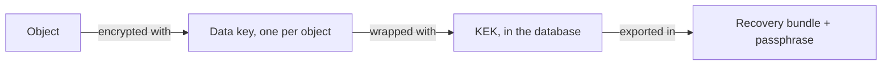

# Encryption Keys

Every object is encrypted at rest with AES-256-GCM, always; there is nothing
to turn on. Each object has its own data key, and that key is wrapped with
the installation's **key encryption key** (KEK). The KEK is generated on the
first start and kept in the database.

## The recovery bundle

The bundle is a passphrase-protected copy of every KEK version. If the
database is lost, it is the only way to read the objects again.

1. **Settings → Security → Encryption Recovery Bundle**.
2. Type a passphrase twice; at least the minimum length the form asks for.
3. **Download bundle**, and store the file and the passphrase **outside the
   server**, apart from each other.

The console shows a banner until a bundle has been downloaded. Download a new
one after every rotation.

!!! danger
    MaxIOFS does not keep the passphrase. A bundle without it cannot be
    opened.

## Rotate the key

**Settings → Security → Rotate key** creates a new KEK version:

- New objects use it at once.
- Existing objects are re-wrapped to it in the background. Their data is not
  re-encrypted, only their small data keys. Progress shows under
  **Background Encryption**.
- Everything stays readable during and after.

Rotate on a schedule your policy asks for, or when someone who had access to
the database leaves. Then download a fresh bundle.

## In a cluster

All nodes share the KEK: a node gets it when it joins, and a rotation reaches
every node. Objects move between nodes still encrypted.

## Customer-provided keys (SSE-C)

A client can send its own key with each request instead. MaxIOFS encrypts the
object with it and keeps no copy, so:

- it is blocked by default on every bucket; allow it in the bucket's
  **Settings → Security & Access**;
- it is accepted only over HTTPS;
- the console cannot download, share or rename such objects, and replication
  does not copy them; the client must send the same key to read them.

## Other secrets

OAuth client secrets, LDAP bind passwords, replication keys and share link
keys are also stored encrypted in the database, with a secret kept there too.
The API never returns them.
